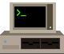
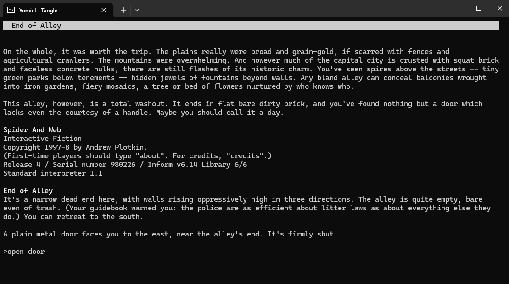

# Yomiel

A Z-machine interpreter and player for interactive fiction made with Inform.



## Download

Releases are for Windows (x64) and Linux (x64). No .NET install is needed.

macOS is untested. To try it, install the [.NET SDK](https://dotnet.microsoft.com/download) and build from source:

```
dotnet publish Yomiel.Tui -c Release -o out
```

## Playing

1. Put story files (`.z5`, `.z7`, `.z8`) in the folder with `yomiel-tui`.
2. Start `yomiel-tui` by double-clicking it or running `./yomiel-tui` in that folder.
3. Pick a story and press Enter.

You can also drag a story file onto `yomiel-tui`, or run `yomiel-tui story.z5`.

Story files can be obtained for free from [IFDB](https://ifdb.org/) and the [IF Archive](https://ifarchive.org/).

Versions 1–4, 6, and Blorb files (`.zblorb`) are not supported.

## Keys

| Key | Action |
|---|---|
| Enter | Play or continue the story (list); send a command (story) |
| F2 | Start the story over (list) |
| Up, Down | Earlier commands |
| Page Up, Page Down | Scroll back |
| Ctrl+Q | Back to the list, or quit if started with a story file |
| Esc | Quit (list) |

Leaving a story keeps its place: Ctrl+Q, Ctrl+C or closing the window. It continues next time. `save` and `restore` in a story keep extra saves by name.

Saves are kept in `%APPDATA%\Yomiel` on Windows and `~/.local/share/yomiel` on Linux (`~/Library/Application Support/Yomiel` on macOS).

## Options

```
yomiel-tui [story | folder] [--new] [--data DIR] [--colors 24|16] [--seed N] [--no-more] [--version]
```

| Option | Effect |
|---|---|
| `--new` | Start the story over instead of continuing it. |
| `--data DIR` | Folder for saves, transcripts and suspended stories. |
| `--colors 16` | Use the 16 standard terminal colours, for terminals without true colour. |
| `--seed N` | Random number seed. |
| `--no-more` | Don't pause at `[MORE]`. |
| `--version` | Print the version. |

## For developers

Yomiel is also a .NET Standard 2.0 library with no dependencies, for putting a Z-machine in other programs. See `docs/library.md` for the API and `docs/development.md` for building and testing.

## License

Yomiel is licensed under the [0BSD License](https://xn--gba.st/kawaiifiveo).
